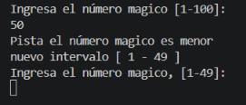

# Programación 1

Este repositorio contiene los programas y ejercicios desarrollados durante la materia de Programación 1.

Los ejercicios están organizados por temas y cada programa se encuentra en su propia carpeta.

## Programas incluidos

### Número magico
Juego de intentar adivinar el número oculto.

### Piedra Papel Tijeras
Juego de piedra papel o tijeras en la termina.

### Tabla 1-10
Programa que te da la tabla de multiplicar del 1 al 10 del número que reciba

## Ejecución de un programa

### Número magico
Para ejecutarlo primero abres el archivo, le das click a Run y seleccionas Run Without Debugging, luego si te aparecen más opciones seleccion Python Debugger despues de darle a Run Without Debugging.
Luego proporciona un número en el rango que te solicita el programa.


# Programación 1

Este repositorio contiene los programas y ejercicios desarrollados durante la materia de Programación 1.

## Contenido

| Programa | Función |
| --- | --- |
| 'Número-Magico/NúmeroMagico.py' | Crea un número secreto que se intenta encontrar |
| 'Piedra-Papel-Tijeras/PiedraPapelTijeras.py' | Juego en terminal de piedra papel o tijeras |
| 'Tabla1-10/Tabla1-10.py' | Devuelve la tabla del 1 al 10 del número dado |

## Cómo ejecutar los programas

### Número Magico

Este programa crea un número oculto que se intenta adivinar.

**Requisitos**
- Tener instalado Python 3.

**Ubicación** 'Número-Magico/NúmeroMagico.py'

**Para ejecutarlo:**

```bash
py Número-Magico/NúmeroMagico.py
```

## Ejemplo de funcionamiento

Al ejecutar 'NúmeroMagico.py', el programa solicita un número.

**Ejemplo de entrada y salida:**

```text
Ingresa el número magico [1-100]:
50

Pista el número magico es menor
nuevo intervalo [ 1 - 49 ]
Ingresa el número magico, [1-49]:
```



## Autor
Ivan